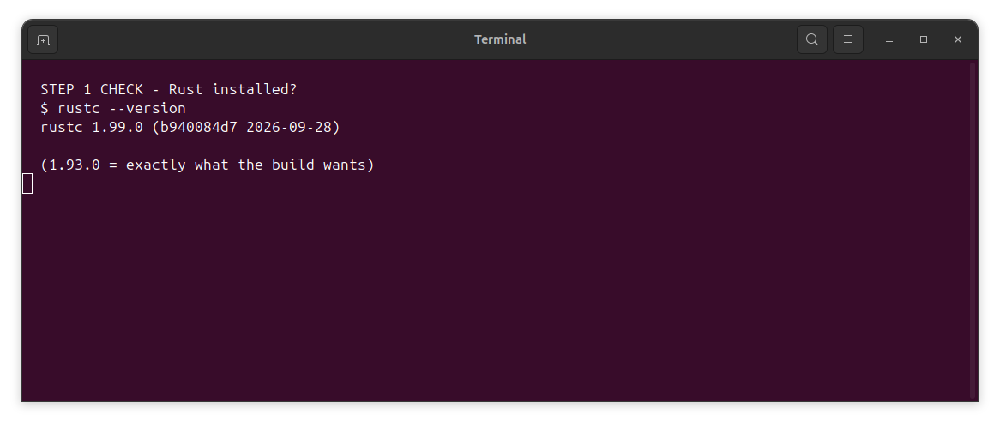
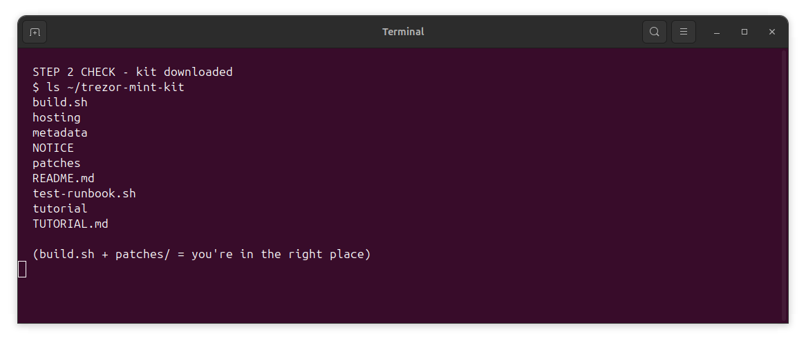
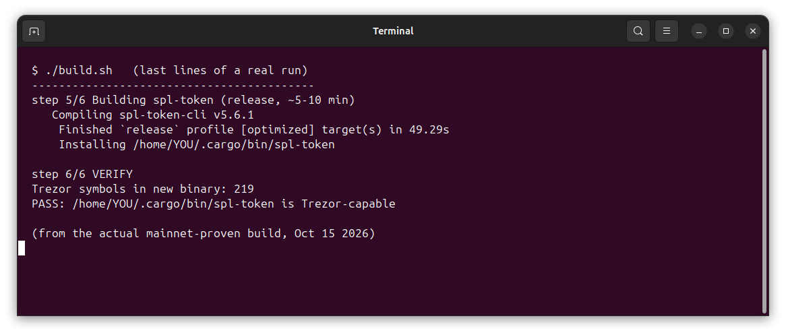
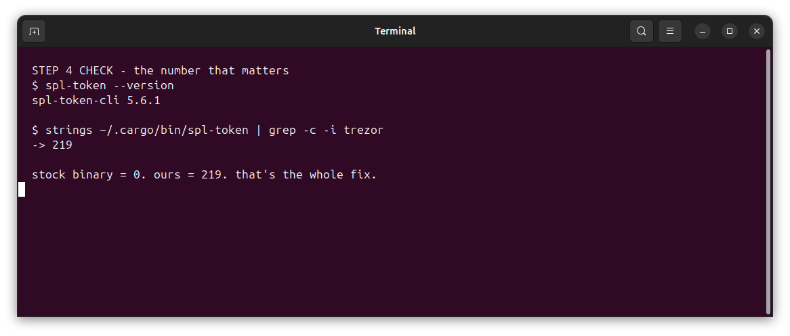
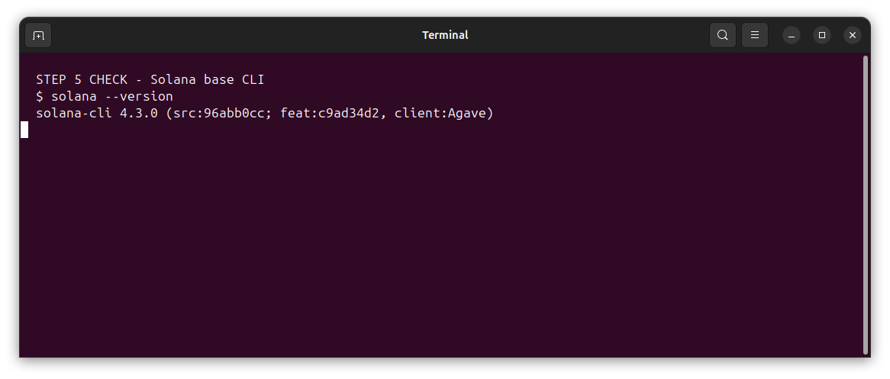
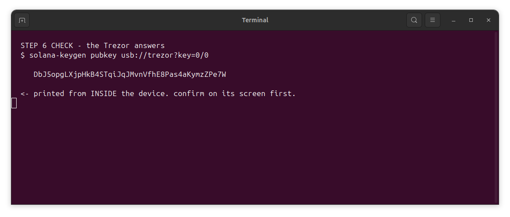

# Build it yourself — the 15-minute guide

**What you'll make:** a copy of Solana's official `spl-token` command-line tool that can talk to
a **Trezor** hardware wallet. The normal version can't — it literally errors with
`not a manufacturer`. This guide fixes that, on a fresh Ubuntu machine, in about 15 minutes
(10 of which is the computer compiling — you just wait).

**You need:**

| Thing | Why |
|---|---|
| A computer with **Ubuntu 22.04 or 24.04** (fresh VM is perfect) | the build runs on Linux |
| About **5 GB free disk** | the source code + compiled pieces |
| **Terminal** (press `Ctrl+Alt+T`) | where everything happens |
| Internet | downloads the source + tools |
| A **Trezor Model T** (only at the END — not needed to build) | the wallet that will sign |

> No Trezor needed until Step 7. You can build everything first, device still in its box.

---

## Step 1 — Install the two tools the build needs (2 min)

Open a terminal (`Ctrl+Alt+T`) and paste this, press Enter, type your password when asked:

```bash
curl --proto '=https' --tlsv1.2 -sSf https://sh.rustup.rs | sh -s -- -y --default-toolchain 1.93.0
source "$HOME/.cargo/env"
sudo apt update && sudo apt install -y git python3 binutils
```

**What that did:** Rust is the programming language the Solana tools are written in.
`rustup` installs it. Git downloads source code. `python3` and `binutils` help the build script.

✅ **Check it worked:** paste `rustc --version` — you should see `rustc 1.93.0`.



---

## Step 2 — Download this kit (30 sec)

```bash
cd ~
git clone https://github.com/agi-digital-dot/trezor-mint-kit.git
cd trezor-mint-kit
```

✅ **Check:** `ls` shows `build.sh`, `patches/`, `README.md` and a few more.



---

## Step 3 — Run the build (10 min, mostly waiting)

```bash
chmod +x build.sh
./build.sh
```

The script does 6 things, and tells you as it goes:

```
1/6 Toolchain check            ← makes sure Rust is the right version
2/6 Fetching official repo     ← downloads Solana's real token-2022 code (pinned commit)
3/6 Restoring proven lockfile  ← freezes every dependency to known-good versions
   Graft integrity: PASS      ← math-checks the Trezor module hasn't been tampered with
4/6 Locking dependencies       ← swaps in the Trezor-capable wallet library
5/6 Building spl-token         ← ~5-10 minutes of compiling. Go get a drink.
6/6 VERIFY                     ← counts Trezor code inside the finished binary
```

✅ **Check:** near the end you MUST see:

```
Trezor symbols in new binary: 219
PASS: /home/YOU/.cargo/bin/spl-token is Trezor-capable
```

If it says `0` — the build refuses to install. That's the safety gate doing its job.



---

## Step 4 — Prove it worked (10 sec)

```bash
spl-token --version
strings ~/.cargo/bin/spl-token | grep -c -i trezor
```

First command: `spl-token-cli 5.6.1`.
Second command: a number **bigger than 0** (we got 219). The stock version prints `0` —
that's the whole difference.



---

## Step 5 — Install Solana's other tools (2 min)

The `spl-token` tool needs Solana's base CLI alongside it:

```bash
sh -c "$(curl -sSfL https://release.anza.xyz/stable/install)"
source "$HOME/.profile"
```

✅ **Check:** `solana --version` prints something like `solana-cli 2.x`.



---

## Step 6 — Plug in your Trezor (1 min)

1. Plug the **Trezor Model T** into a USB port.
2. If Trezor Suite is open, **close it** (it hogs the device).
3. Install the little bridge program that lets your computer talk to the Trezor:

```bash
sudo apt install -y trezord   # or download from trezor.io/start
```

✅ **Check — the moment of truth.** Ask the device for its address:

```bash
solana-keygen pubkey usb://trezor?key=0/0
```

Your Trezor screen lights up, you confirm — and the terminal prints a Solana address
that **lives inside your hardware**. No file on your computer contains that key. Ever.



---

## Step 7 — Make your token (the part this was all for)

```bash
solana config set --url mainnet-beta
spl-token --program-2022 create-token usb://trezor?key=0/0 \
  --enable-metadata --decimals 6 \
  --transfer-fee-basis-points 193 --transfer-fee-maximum-fee 6433326900
```

Your Trezor shows the transaction. You physically confirm it. The mint is born on hardware.

Then name it, mint your supply, renounce — the full ceremony is in the main
[README](README.md#mint-ceremony-you-action-everything-keys-never-leave-the-device).

---

## Troubleshooting

| Error | Meaning | Fix |
|---|---|---|
| `rustc: command not found` | Step 1 didn't finish | run `source "$HOME/.cargo/env"` again |
| `rustc 1.9x is not supported` | wrong Rust version | `rustup default 1.93.0` |
| `Trezor symbols: 0` | something replaced the graft | re-clone and re-run; the gate refused to install a bad build |
| `not a manufacturer` | you ran the STOCK spl-token, not the rebuilt one | `which spl-token` must show `~/.cargo/bin/spl-token` |
| Trezor never asks to confirm | Trezor Suite open, or bridge down | close Suite, `sudo systemctl restart trezord`, replug |
| `BlockhashNotFound` after confirming too slowly | tx expired mid-confirm | check if it landed first (Solscan), then just re-run |

---

*Built and proven on mainnet Oct 15 2026 — mint
[3e2P...zXAM](https://solscan.io/token/3e2PYneVBXTyemNiSQ5VVkuYM4bYNPxLqvWkKjA5zXAM),
the first documented Trezor-signed token creation on Solana.*
